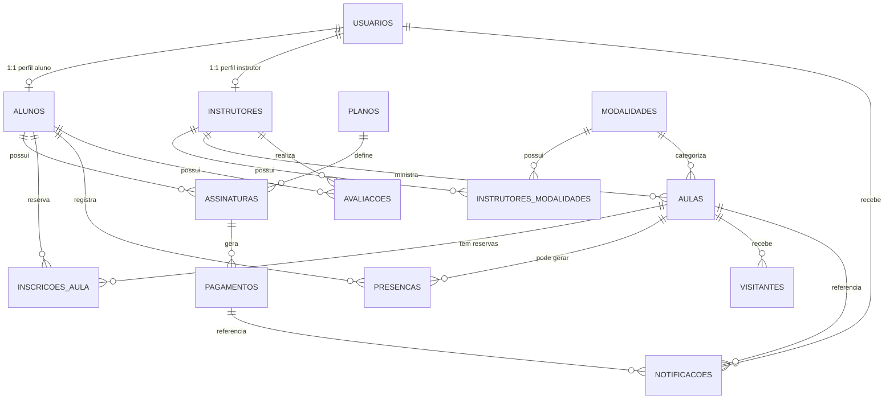

# Arquitetura — Sistema de Gestão de Academia

> Documento de arquitetura do projeto final de DAD.
> Stack: **Electron + Vite + TypeScript + React + Tailwind + MySQL (mysql2)**.
> Este documento ainda **não contém código de aplicação**. Ele define o modelo, as camadas, os contratos e o plano de trabalho.

---

## 0. Decisões gerais e correções do plano anterior

### 0.1 Princípios

1. **O processo main é o único que fala com o banco e com serviços externos.** O renderer (React) nunca recebe credenciais, nunca importa `mysql2` e nunca acessa o sistema de arquivos.
2. **Contratos primeiro.** Os tipos e canais IPC são fechados no dia 1 para que todos trabalhem em paralelo com dados mockados.
3. **Cada camada tem uma responsabilidade só.** Model conhece regras do domínio; Repository só fala SQL; Service decide regras de negócio; IPC só valida/autoriza/roteia; UI só apresenta.
4. **Segurança no main, não só na tela.** Esconder um botão no React é experiência de usuário; a autorização de verdade acontece antes de executar o service.
5. **MySQL compartilhado da universidade.** Nada de SQLite, nada de banco local como fonte oficial.

### 0.2 Correções em relação ao plano recebido

| Problema do plano anterior | Correção neste documento |
|---|---|
| Usava SQLite local | MySQL compartilhado, `mysql2/promise`, pool, `database/schema.sql` e `database/seed.sql` versionados, credenciais em `.env` |
| Previa só 1 API | 4 APIs distintas com finalidades reais: clima, CEP, feriados e catálogo de exercícios |
| Não cobria CRUD de todas as entidades nem justificava segurança | Matriz de CRUD para as 14 tabelas + seção de segurança com justificativa item por item |
| Dev 1 virava gargalo | Contratos congelados no dia 1, mocks, cada dono de domínio escreve seu IPC/repositório/tela a partir de um template, revisão cruzada |
| Um único dono de toda a UI | Colega C é dono do design system e das telas complexas; A e B montam as telas simples dos seus domínios usando os componentes do C |

---

## 1. Modelo do banco

### 1.1 Visão geral

O banco tem **14 tabelas de negócio** (o mínimo exigido é 6). Todas usam:

- Engine **InnoDB** (necessário para chaves estrangeiras e transações);
- Charset **utf8mb4** / collation `utf8mb4_unicode_ci`;
- Nomes em português e `snake_case`;
- Chaves estrangeiras reais;
- `criado_em` e `atualizado_em` nas entidades principais.

A separação principal é:

- `usuarios` = **conta de acesso** (login, senha, perfil);
- `alunos` e `instrutores` = **papéis do domínio**, cada um ligado 1:1 a um usuário;
- As demais tabelas representam planos, pagamentos, aulas, presenças, avaliações, visitantes e notificações.

Isso evita repetir e-mail/senha em três tabelas e permite que o login seja único.



### 1.2 Tabelas, colunas e chaves

#### `usuarios` — conta de acesso

| Coluna | Tipo | Regra |
|---|---|---|
| `id` | BIGINT UNSIGNED | PK, auto incremento |
| `nome` | VARCHAR(120) | NOT NULL |
| `email` | VARCHAR(160) | NOT NULL, UNIQUE |
| `senha_hash` | VARCHAR(255) | NOT NULL — nunca senha em texto puro |
| `perfil` | ENUM(`admin`,`instrutor`,`aluno`) | NOT NULL |
| `ativo` | BOOLEAN | NOT NULL, default TRUE |
| `ultimo_login` | DATETIME | NULL |
| `criado_em` | DATETIME | NOT NULL, default CURRENT_TIMESTAMP |
| `atualizado_em` | DATETIME | NOT NULL, default CURRENT_TIMESTAMP ON UPDATE |

Índices: `(perfil, ativo)`.

Relações: 1:1 com `alunos`; 1:1 com `instrutores`; 1:N com `notificacoes`.

#### `alunos` — dados do aluno

| Coluna | Tipo | Regra |
|---|---|---|
| `id` | BIGINT UNSIGNED | PK |
| `usuario_id` | BIGINT UNSIGNED | NOT NULL, UNIQUE, FK → `usuarios.id` ON DELETE CASCADE |
| `cpf` | CHAR(11) | NOT NULL, UNIQUE — somente dígitos |
| `data_nascimento` | DATE | NOT NULL |
| `telefone` | VARCHAR(20) | NOT NULL |
| `cep` | CHAR(8) | NULL |
| `logradouro` | VARCHAR(160) | NULL |
| `numero` | VARCHAR(20) | NULL |
| `complemento` | VARCHAR(80) | NULL |
| `bairro` | VARCHAR(80) | NULL |
| `cidade` | VARCHAR(80) | NULL |
| `estado` | CHAR(2) | NULL |
| `contato_emergencia` | VARCHAR(120) | NULL |
| `observacoes_saude` | TEXT | NULL — dado sensível, acesso restrito |
| `ativo` | BOOLEAN | NOT NULL, default TRUE |
| `criado_em` | DATETIME | NOT NULL |
| `atualizado_em` | DATETIME | NOT NULL |

Relações: 1:N com `assinaturas`, `inscricoes_aula`, `presencas` e `avaliacoes`.

#### `instrutores` — dados do instrutor

| Coluna | Tipo | Regra |
|---|---|---|
| `id` | BIGINT UNSIGNED | PK |
| `usuario_id` | BIGINT UNSIGNED | NOT NULL, UNIQUE, FK → `usuarios.id` ON DELETE CASCADE |
| `cref` | VARCHAR(30) | NOT NULL, UNIQUE |
| `bio` | TEXT | NULL |
| `ativo` | BOOLEAN | NOT NULL, default TRUE |
| `criado_em` | DATETIME | NOT NULL |
| `atualizado_em` | DATETIME | NOT NULL |

Relações: N:N com `modalidades` via `instrutores_modalidades`; 1:N com `aulas` e `avaliacoes`.

#### `modalidades` — musculação, funcional, dança, spin etc.

| Coluna | Tipo | Regra |
|---|---|---|
| `id` | BIGINT UNSIGNED | PK |
| `nome` | VARCHAR(80) | NOT NULL, UNIQUE |
| `descricao` | VARCHAR(255) | NULL |
| `ativo` | BOOLEAN | NOT NULL, default TRUE |
| `criado_em` | DATETIME | NOT NULL |
| `atualizado_em` | DATETIME | NOT NULL |

Relações: N:N com `instrutores`; 1:N com `aulas`.

#### `instrutores_modalidades` — tabela de ligação N:N

| Coluna | Tipo | Regra |
|---|---|---|
| `instrutor_id` | BIGINT UNSIGNED | FK → `instrutores.id` ON DELETE CASCADE |
| `modalidade_id` | BIGINT UNSIGNED | FK → `modalidades.id` ON DELETE CASCADE |

PK composta: (`instrutor_id`, `modalidade_id`). Índice em `modalidade_id`.

Não tem `UPDATE`: para trocar, remove e insere de novo. Isso é suficiente para o CRUD da associação.

#### `planos` — mensal, trimestral, semestral, anual

| Coluna | Tipo | Regra |
|---|---|---|
| `id` | BIGINT UNSIGNED | PK |
| `nome` | VARCHAR(80) | NOT NULL, UNIQUE |
| `tipo` | ENUM(`mensal`,`trimestral`,`semestral`,`anual`) | NOT NULL |
| `duracao_meses` | TINYINT UNSIGNED | NOT NULL, CHECK > 0 |
| `valor` | DECIMAL(10,2) | NOT NULL, CHECK >= 0 |
| `descricao` | VARCHAR(255) | NULL |
| `ativo` | BOOLEAN | NOT NULL, default TRUE |
| `criado_em` | DATETIME | NOT NULL |
| `atualizado_em` | DATETIME | NOT NULL |

Relações: 1:N com `assinaturas`.

#### `assinaturas` — vínculo aluno ↔ plano

| Coluna | Tipo | Regra |
|---|---|---|
| `id` | BIGINT UNSIGNED | PK |
| `aluno_id` | BIGINT UNSIGNED | NOT NULL, FK → `alunos.id` ON DELETE RESTRICT |
| `plano_id` | BIGINT UNSIGNED | NOT NULL, FK → `planos.id` ON DELETE RESTRICT |
| `data_inicio` | DATE | NOT NULL |
| `data_fim` | DATE | NOT NULL |
| `valor_contratado` | DECIMAL(10,2) | NOT NULL |
| `status` | ENUM(`ativa`,`vencida`,`cancelada`,`suspensa`) | NOT NULL, default `ativa` |
| `criado_em` | DATETIME | NOT NULL |
| `atualizado_em` | DATETIME | NOT NULL |

Índices: `(aluno_id, status)`, `(data_fim)`.

Regra de “um plano ativo por aluno” é garantida no **service** dentro de uma transação, porque o MySQL não tem índice parcial simples. O banco ainda ajuda com índice e FK.

#### `pagamentos` — mensalidades

| Coluna | Tipo | Regra |
|---|---|---|
| `id` | BIGINT UNSIGNED | PK |
| `assinatura_id` | BIGINT UNSIGNED | NOT NULL, FK → `assinaturas.id` ON DELETE RESTRICT |
| `competencia` | DATE | NOT NULL — sempre dia 01 do mês |
| `valor` | DECIMAL(10,2) | NOT NULL |
| `data_vencimento` | DATE | NOT NULL |
| `data_pagamento` | DATE | NULL |
| `status` | ENUM(`pendente`,`pago`,`atrasado`,`cancelado`) | NOT NULL, default `pendente` |
| `metodo` | ENUM(`dinheiro`,`pix`,`cartao`,`boleto`,`transferencia`) | NULL |
| `observacao` | VARCHAR(255) | NULL |
| `criado_em` | DATETIME | NOT NULL |
| `atualizado_em` | DATETIME | NOT NULL |

UNIQUE (`assinatura_id`, `competencia`) evita cobrança duplicada no mesmo mês.

Índices: `(status, data_vencimento)`, `(data_pagamento)`.

#### `aulas` — turmas e horários

| Coluna | Tipo | Regra |
|---|---|---|
| `id` | BIGINT UNSIGNED | PK |
| `modalidade_id` | BIGINT UNSIGNED | NOT NULL, FK → `modalidades.id` ON DELETE RESTRICT |
| `instrutor_id` | BIGINT UNSIGNED | NOT NULL, FK → `instrutores.id` ON DELETE RESTRICT |
| `titulo` | VARCHAR(120) | NOT NULL |
| `data_hora_inicio` | DATETIME | NOT NULL |
| `duracao_min` | SMALLINT UNSIGNED | NOT NULL, CHECK > 0 |
| `capacidade_max` | SMALLINT UNSIGNED | NOT NULL, CHECK > 0 |
| `local` | ENUM(`interna`,`externa`) | NOT NULL |
| `local_descricao` | VARCHAR(120) | NULL |
| `status` | ENUM(`agendada`,`confirmada`,`cancelada`,`remarcada`,`concluida`) | NOT NULL, default `agendada` |
| `criado_em` | DATETIME | NOT NULL |
| `atualizado_em` | DATETIME | NOT NULL |

Índices: `(data_hora_inicio, status)`, `(instrutor_id)`, `(modalidade_id)`.

#### `inscricoes_aula` — reservas/vagas

| Coluna | Tipo | Regra |
|---|---|---|
| `id` | BIGINT UNSIGNED | PK |
| `aula_id` | BIGINT UNSIGNED | NOT NULL, FK → `aulas.id` ON DELETE CASCADE |
| `aluno_id` | BIGINT UNSIGNED | NOT NULL, FK → `alunos.id` ON DELETE CASCADE |
| `status` | ENUM(`confirmada`,`cancelada`,`presente`,`falta`) | NOT NULL, default `confirmada` |
| `criado_em` | DATETIME | NOT NULL |
| `atualizado_em` | DATETIME | NOT NULL |

UNIQUE (`aula_id`, `aluno_id`) evita reserva duplicada.

A lotação é controlada no service com transação e `SELECT ... FOR UPDATE` na linha da aula, para duas reservas simultâneas não passarem do limite.

#### `presencas` — check-in diário

| Coluna | Tipo | Regra |
|---|---|---|
| `id` | BIGINT UNSIGNED | PK |
| `aluno_id` | BIGINT UNSIGNED | NOT NULL, FK → `alunos.id` ON DELETE CASCADE |
| `aula_id` | BIGINT UNSIGNED | NULL, FK → `aulas.id` ON DELETE SET NULL |
| `data_presenca` | DATE | NOT NULL |
| `origem` | ENUM(`aula`,`livre`,`experimental`) | NOT NULL, default `aula` |
| `criado_em` | DATETIME | NOT NULL |

**UNIQUE (`aluno_id`, `data_presenca`)** é a trava de **1 aula por dia** no banco.

O service também valida e devolve um erro amigável (`CONFLICT`), mas o banco impede duplicação mesmo se duas telas clicarem ao mesmo tempo.

#### `avaliacoes` — acompanhamento físico

| Coluna | Tipo | Regra |
|---|---|---|
| `id` | BIGINT UNSIGNED | PK |
| `aluno_id` | BIGINT UNSIGNED | NOT NULL, FK → `alunos.id` ON DELETE CASCADE |
| `instrutor_id` | BIGINT UNSIGNED | NULL, FK → `instrutores.id` ON DELETE SET NULL |
| `data_avaliacao` | DATE | NOT NULL |
| `peso_kg` | DECIMAL(5,2) | NOT NULL |
| `altura_cm` | SMALLINT UNSIGNED | NOT NULL |
| `percentual_gordura` | DECIMAL(5,2) | NULL |
| `cintura_cm` | DECIMAL(5,2) | NULL |
| `quadril_cm` | DECIMAL(5,2) | NULL |
| `peito_cm` | DECIMAL(5,2) | NULL |
| `braco_cm` | DECIMAL(5,2) | NULL |
| `coxa_cm` | DECIMAL(5,2) | NULL |
| `observacoes` | TEXT | NULL |
| `criado_em` | DATETIME | NOT NULL |
| `atualizado_em` | DATETIME | NOT NULL |

Índice: `(aluno_id, data_avaliacao)`.

#### `visitantes` — aulas experimentais e visitas

| Coluna | Tipo | Regra |
|---|---|---|
| `id` | BIGINT UNSIGNED | PK |
| `nome` | VARCHAR(120) | NOT NULL |
| `telefone` | VARCHAR(20) | NOT NULL |
| `email` | VARCHAR(160) | NULL |
| `aula_id` | BIGINT UNSIGNED | NULL, FK → `aulas.id` ON DELETE SET NULL |
| `data_visita` | DATE | NOT NULL |
| `tipo` | ENUM(`experimental`,`visitante`) | NOT NULL |
| `status` | ENUM(`agendado`,`compareceu`,`faltou`,`convertido`) | NOT NULL, default `agendado` |
| `observacoes` | VARCHAR(255) | NULL |
| `criado_em` | DATETIME | NOT NULL |
| `atualizado_em` | DATETIME | NOT NULL |

Índice: `(data_visita, status)`.

#### `notificacoes` — histórico de e-mails/alertas

| Coluna | Tipo | Regra |
|---|---|---|
| `id` | BIGINT UNSIGNED | PK |
| `usuario_id` | BIGINT UNSIGNED | NULL, FK → `usuarios.id` ON DELETE SET NULL |
| `aula_id` | BIGINT UNSIGNED | NULL, FK → `aulas.id` ON DELETE SET NULL |
| `pagamento_id` | BIGINT UNSIGNED | NULL, FK → `pagamentos.id` ON DELETE SET NULL |
| `destinatario_email` | VARCHAR(160) | NOT NULL |
| `tipo` | ENUM(`vencimento`,`chuva`,`experimental`,`geral`) | NOT NULL |
| `canal` | ENUM(`email`,`sistema`) | NOT NULL, default `email` |
| `assunto` | VARCHAR(160) | NOT NULL |
| `mensagem` | TEXT | NOT NULL |
| `status` | ENUM(`pendente`,`enviado`,`falhou`) | NOT NULL, default `pendente` |
| `erro` | VARCHAR(255) | NULL |
| `criado_em` | DATETIME | NOT NULL |
| `enviado_em` | DATETIME | NULL |

Serve para evitar reenvio duplicado, mostrar ao gestor o que foi enviado e registrar falhas.

> **Extra opcional:** `logs_auditoria` (`usuario_id`, `acao`, `entidade`, `entidade_id`, `detalhes JSON`, `criado_em`). É *append-only* por segurança; não é uma entidade de CRUD e não entra na contagem obrigatória.

### 1.3 Checagem de CRUD por entidade

| Entidade | Create | Read | Update | Delete | Onde aparece |
|---|---|---|---|---|---|
| `usuarios` | admin cria | lista/obter | editar perfil/ativo/senha | desativar ou excluir | Tela Usuários |
| `alunos` | cadastro | lista/ficha | editar dados | desativar/excluir | Tela Alunos |
| `instrutores` | cadastro | lista/ficha | editar dados/CREC | desativar/excluir | Tela Instrutores |
| `modalidades` | admin | lista | editar | excluir se não houver aulas | Tela Modalidades |
| `instrutores_modalidades` | associar | listar por instrutor | — (remove/insere) | desassociar | Ficha do instrutor |
| `planos` | admin | lista | editar valor/duração | excluir se não houver assinatura | Tela Planos |
| `assinaturas` | vincular aluno/plano | lista/ficha | renovar/cancelar | excluir/cancelar | Tela Assinaturas |
| `pagamentos` | gerar/criar | lista/ficha | registrar pagamento/status | cancelar/excluir (admin) | Tela Financeiro |
| `aulas` | admin/instrutor | agenda/lista | remarcar/editar | cancelar/excluir | Tela Aulas |
| `inscricoes_aula` | reservar | lista de presença | confirmar/cancelar | cancelar reserva | Tela Aula |
| `presencas` | check-in | histórico | corrigir origem/data | excluir (admin) | Tela Presenças |
| `avaliacoes` | instrutor/admin | histórico/ficha | editar | excluir | Tela Avaliações |
| `visitantes` | admin/instrutor | lista | editar status | excluir | Tela Visitantes |
| `notificacoes` | sistema/admin | lista | reenviar/status | excluir (admin) | Tela Notificações |

**Delete lógico x físico:** entidades com histórico financeiro (`usuarios`, `alunos`, `instrutores`, `planos`, `modalidades`) usam `ativo = 0` como “excluir” padrão para não apagar histórico. Entidades sem histórico crítico (`aulas`, `inscricoes_aula`, `presencas`, `avaliacoes`, `visitantes`, `notificacoes`) podem ter DELETE físico. A UI sempre oferece a ação “Excluir”; o service decide o comportamento e registra a ação.

### 1.4 Regras de integridade importantes

| Regra | Onde é garantida |
|---|---|
| 1 aula/presença por dia | UNIQUE (`aluno_id`, `data_presenca`) + validação no `PresencaService` |
| Lotação máxima | Transação + `SELECT ... FOR UPDATE` em `aulas` + contagem de inscrições confirmadas |
| Reserva duplicada | UNIQUE (`aula_id`, `aluno_id`) |
| Cobrança duplicada no mês | UNIQUE (`assinatura_id`, `competencia`) |
| Um plano ativo por aluno | Transação no `AssinaturaService` |
| Não excluir plano/aluno com histórico | FKs `ON DELETE RESTRICT` |
| Senha nunca em texto puro | `senha_hash` + bcrypt no `AuthService` |
| Dados órfãos | FKs com `CASCADE`, `RESTRICT` ou `SET NULL` conforme o caso |

---

## 2. Classes por camada

### 2.1 Model (domínio)

São classes/interfaces que representam os dados e as regras que não dependem de banco nem de tela.

| Classe/Interface | Responsabilidade |
|---|---|
| `Pessoa` (abstrata) | Campos comuns: id, nome, e-mail, ativo |
| `Usuario` | Perfil, senha hash, regra `temPerfil()` |
| `Aluno` | CPF, endereço, data de nascimento; regras `podeFazerCheckInHoje()`, `assinaturaAtiva()` |
| `Instrutor` | CREF, modalidades; regra `podeMinistrar(modalidade)` |
| `Modalidade` | Nome, descrição, ativo |
| `Plano` | Tipo, duração, valor; regra `calcularDataFim(dataInicio)` |
| `Assinatura` | Datas, valor, status; regras `estaAtiva()`, `diasParaVencer()`, `renovar()` |
| `Pagamento` | Competência, vencimento, status; regras `estaAtrasado()`, `registrarPagamento()` |
| `Aula` | Horário, capacidade, local; regras `temVaga()`, `eExterna()`, `podeReceberAluno()` |
| `InscricaoAula` | Status da reserva e transições permitidas |
| `Presenca` | Data, origem; regra `validarUmPorDia(presencasDoDia)` |
| `Avaliacao` | Peso, medidas, gordura; regras `calcularIMC()`, `compararCom(outra)` |
| `Visitante` | Dados da visita; regra `podeConverter()` |
| `Notificacao` | Tipo, canal, status; regras `marcarEnviada()`, `marcarFalha()` |
| `Endereco` | Value object de endereço |
| `Feriado` / `PrevisaoClima` | Value objects de APIs externas |

> Regra prática: **model não executa SQL e não conhece React**. Ele só protege invariantes simples.

### 2.2 Repository (acesso a dados)

Só existe no processo main. Recebe e devolve models, usa `mysql2` com **prepared statements** (`execute` com `?`) e nunca decide regra de negócio.

| Classe | Responsabilidade |
|---|---|
| `BaseRepository` | Pool, `execute`, helpers de transação, mapeamento de linhas |
| `UsuarioRepository` | CRUD de usuários, `findByEmail`, atualizar último login |
| `AlunoRepository` | CRUD de alunos, busca com filtros, ficha completa |
| `InstrutorRepository` | CRUD de instrutores + associação com modalidades |
| `ModalidadeRepository` | CRUD de modalidades |
| `PlanoRepository` | CRUD de planos |
| `AssinaturaRepository` | CRUD, assinatura ativa por aluno, vencendo |
| `PagamentoRepository` | CRUD, inadimplentes, resumo financeiro, relatório |
| `AulaRepository` | CRUD, agenda, vagas, aulas externas do dia seguinte |
| `InscricaoAulaRepository` | CRUD de reservas, contagem de ocupadas |
| `PresencaRepository` | CRUD, presença do dia, frequência por período |
| `AvaliacaoRepository` | CRUD, histórico e série de evolução |
| `VisitanteRepository` | CRUD de visitantes |
| `NotificacaoRepository` | CRUD, pendentes, evitar duplicidade |
| `ExercicioFavoritoRepository` | (extra) favoritos do instrutor |

**Divisão para não gargalar:** o Colega A é dono do `BaseRepository` e dos repositórios de cadastros/financeiro. B e C escrevem os repositórios dos seus domínios (aulas/presenças e avaliações/visitantes/notificações) seguindo o template do A, e o A revisa o SQL. Assim o A não vira o único gargalo.

### 2.3 Service (regras de negócio)

Orquestra repositórios, valida entradas, aplica permissões de domínio e chama integrações externas. É aqui que ficam as regras que o enunciado exige.

| Classe | Responsabilidade |
|---|---|
| `AuthService` | Login, logout, sessão, troca de senha, rate limit de tentativas |
| `UsuarioService` | CRUD de usuários e troca de perfil |
| `AlunoService` | CRUD de alunos, perfil do aluno, frequência, inadimplentes |
| `InstrutorService` | CRUD de instrutores e vínculo com modalidades |
| `ModalidadeService` | CRUD de modalidades |
| `PlanoService` | CRUD de planos e cálculo de duração |
| `AssinaturaService` | Criar/renovar/cancelar assinatura, garantir um plano ativo |
| `PagamentoService` | CRUD de pagamentos, registrar pagamento, gerar mensalidades, marcar atrasados |
| `FinanceiroService` | Resumo do mês, relatório de faturamento, inadimplência |
| `AulaService` | CRUD de aulas, remarcação, risco climático, regras de local |
| `InscricaoService` | Reservar/cancelar vaga, validar lotação e duplicidade |
| `PresencaService` | Check-in, trava de 1 aula/dia, lista de presença, assiduidade |
| `AvaliacaoService` | CRUD de avaliações, cálculo de IMC e série de evolução |
| `VisitanteService` | CRUD de visitantes e conversão em aluno (extra) |
| `NotificacaoService` | Criar/logar notificações, enviar aviso de vencimento e de chuva, reenviar |
| `DashboardService` | Agregar KPIs do gestor |
| `ClimaService` | Consultar Open-Meteo, calcular risco de chuva, cache |
| `CepService` | Consultar ViaCEP, validar CEP, normalizar endereço |
| `FeriadoService` | Consultar BrasilAPI Feriados, cache por ano |
| `ExercicioService` | Buscar catálogo no Wger, favoritos do instrutor (extra) |
| `EmailService` | Enviar e-mail via SMTP/Resend, montar templates, registrar resultado |
| `PermissionService` | `pode(perfil, acao, recurso)`, `exigirDono()` |
| `AuditService` | (extra) registrar ações sensíveis |

### 2.4 IPC (ponte main ↔ renderer)

| Arquivo/Classe | Responsabilidade |
|---|---|
| `shared/ipc-contracts.ts` | Nomes dos canais e interface `Api` tipada |
| `shared/types.ts` | Tipos de entrada/saída usados pelos dois lados |
| `shared/schemas.ts` | Schemas Zod de validação |
| `shared/errors.ts` | Códigos de erro e classe `ApiError` |
| `main/ipc/index.ts` | Registra todos os handlers no boot |
| `main/ipc/guards.ts` | `withAuth`, `withRole`, `withValidation`, envelope de erro |
| `main/ipc/auth.ipc.ts` | Canais de login/logout/senha |
| `main/ipc/alunos.ipc.ts` | Canais de alunos |
| `main/ipc/aulas.ipc.ts` | Canais de aulas/inscrições/presenças |
| `main/ipc/financeiro.ipc.ts` | Canais de assinaturas/pagamentos/relatórios |
| `main/ipc/avaliacoes.ipc.ts` | Canais de avaliações |
| `main/ipc/notificacoes.ipc.ts` | Canais de notificações/e-mails |
| `main/ipc/integracoes.ipc.ts` | Canais de clima, CEP, feriados e exercícios |
| `preload/index.ts` | `contextBridge` expondo apenas `window.api` |
| `preload/api.ts` | Implementação tipada que chama `ipcRenderer.invoke` |

**Regra:** o handler IPC não contém regra de negócio. Ele valida, verifica sessão/perfil, chama o service e devolve o resultado.

### 2.5 UI (renderer)

| Grupo | Responsabilidade |
|---|---|
| `components/ui` | Design system: Button, Input, Select, Modal, Table, Card, Badge, Toast, EmptyState, ConfirmDialog |
| `components/layout` | Sidebar, Topbar, PageHeader, menu por perfil |
| `features/auth` | Login, troca de senha, contexto de sessão |
| `features/alunos` | Lista, ficha, formulário, endereço via CEP |
| `features/instrutores` | Lista, ficha, vínculo com modalidades |
| `features/modalidades` | CRUD simples |
| `features/planos` | CRUD simples |
| `features/assinaturas` | Vincular, renovar, cancelar |
| `features/pagamentos` | Financeiro, registrar pagamento, inadimplentes |
| `features/aulas` | Agenda, criar/editar, vagas, lista de presença |
| `features/presencas` | Check-in, histórico, frequência |
| `features/avaliacoes` | CRUD + gráficos de evolução |
| `features/visitantes` | Experimental/visitante |
| `features/notificacoes` | Histórico, reenvio |
| `features/clima` | Previsão e risco das aulas externas |
| `features/exercicios` | Busca no Wger (extra: favoritos) |
| `features/dashboard` | KPIs, faturamento, inadimplência |
| `features/portal-aluno` | Medidas, frequência e aulas do aluno |
| `hooks` | `useAuth`, `useApi`, `useDebounce`, `usePagination` |
| `lib/api.ts` | Wrapper de `window.api` com tratamento de erro e toast |
| `mocks` | Implementação mockada da `Api` + dados de exemplo |
| `contexts/AuthContext` | Sessão atual, logout, proteção de rotas |

**Stack de UI sugerida:** React Router, Tailwind, Recharts (gráficos), React Hook Form + Zod (formulários), Lucide React (ícones). React Query é opcional; se o grupo preferir simplicidade, usar hooks próprios com `useEffect`.

### 2.6 Integrações externas

| Cliente | Responsabilidade |
|---|---|
| `HttpClient` | `fetch` com timeout, HTTPS, tratamento de erro e log |
| `OpenMeteoClient` | Previsão de chuva por coordenada/data |
| `ViaCepClient` | Consulta de CEP |
| `BrasilApiFeriadoClient` | Feriados nacionais por ano |
| `WgerClient` | Catálogo de exercícios |
| `EmailClient` | SMTP/Resend com templates |

Todos ficam no main e nunca recebem segredo do renderer.

---

## 3. Estrutura de pastas

```text
projeto-final-desktop/
├─ docs/
│  ├─ requisitos.md
│  └─ ARQUITETURA.md
├─ database/
│  ├─ schema.sql
│  ├─ seed.sql
│  └─ README.md
├─ scripts/
│  ├─ gerar-hash-senha.ts
│  └─ testar-conexao.ts
├─ src/
│  ├─ main/
│  │  ├─ index.ts
│  │  ├─ window.ts
│  │  ├─ env.ts
│  │  ├─ db/
│  │  │  ├─ pool.ts
│  │  │  └─ transaction.ts
│  │  ├─ models/
│  │  │  ├─ Pessoa.ts
│  │  │  ├─ Usuario.ts
│  │  │  ├─ Aluno.ts
│  │  │  ├─ Instrutor.ts
│  │  │  ├─ Modalidade.ts
│  │  │  ├─ Plano.ts
│  │  │  ├─ Assinatura.ts
│  │  │  ├─ Pagamento.ts
│  │  │  ├─ Aula.ts
│  │  │  ├─ InscricaoAula.ts
│  │  │  ├─ Presenca.ts
│  │  │  ├─ Avaliacao.ts
│  │  │  ├─ Visitante.ts
│  │  │  └─ Notificacao.ts
│  │  ├─ repositories/
│  │  │  ├─ BaseRepository.ts
│  │  │  ├─ UsuarioRepository.ts
│  │  │  ├─ AlunoRepository.ts
│  │  │  ├─ InstrutorRepository.ts
│  │  │  ├─ ModalidadeRepository.ts
│  │  │  ├─ PlanoRepository.ts
│  │  │  ├─ AssinaturaRepository.ts
│  │  │  ├─ PagamentoRepository.ts
│  │  │  ├─ AulaRepository.ts
│  │  │  ├─ InscricaoAulaRepository.ts
│  │  │  ├─ PresencaRepository.ts
│  │  │  ├─ AvaliacaoRepository.ts
│  │  │  ├─ VisitanteRepository.ts
│  │  │  └─ NotificacaoRepository.ts
│  │  ├─ services/
│  │  │  ├─ AuthService.ts
│  │  │  ├─ UsuarioService.ts
│  │  │  ├─ AlunoService.ts
│  │  │  ├─ InstrutorService.ts
│  │  │  ├─ ModalidadeService.ts
│  │  │  ├─ PlanoService.ts
│  │  │  ├─ AssinaturaService.ts
│  │  │  ├─ PagamentoService.ts
│  │  │  ├─ FinanceiroService.ts
│  │  │  ├─ AulaService.ts
│  │  │  ├─ InscricaoService.ts
│  │  │  ├─ PresencaService.ts
│  │  │  ├─ AvaliacaoService.ts
│  │  │  ├─ VisitanteService.ts
│  │  │  ├─ NotificacaoService.ts
│  │  │  ├─ DashboardService.ts
│  │  │  ├─ ClimaService.ts
│  │  │  ├─ CepService.ts
│  │  │  ├─ FeriadoService.ts
│  │  │  ├─ ExercicioService.ts
│  │  │  └─ PermissionService.ts
│  │  ├─ integrations/
│  │  │  ├─ HttpClient.ts
│  │  │  ├─ OpenMeteoClient.ts
│  │  │  ├─ ViaCepClient.ts
│  │  │  ├─ BrasilApiFeriadoClient.ts
│  │  │  ├─ WgerClient.ts
│  │  │  └─ EmailClient.ts
│  │  ├─ ipc/
│  │  │  ├─ index.ts
│  │  │  ├─ guards.ts
│  │  │  ├─ auth.ipc.ts
│  │  │  ├─ usuarios.ipc.ts
│  │  │  ├─ alunos.ipc.ts
│  │  │  ├─ instrutores.ipc.ts
│  │  │  ├─ modalidades.ipc.ts
│  │  │  ├─ planos.ipc.ts
│  │  │  ├─ assinaturas.ipc.ts
│  │  │  ├─ pagamentos.ipc.ts
│  │  │  ├─ aulas.ipc.ts
│  │  │  ├─ presencas.ipc.ts
│  │  │  ├─ avaliacoes.ipc.ts
│  │  │  ├─ visitantes.ipc.ts
│  │  │  ├─ notificacoes.ipc.ts
│  │  │  ├─ dashboard.ipc.ts
│  │  │  └─ integracoes.ipc.ts
│  │  ├─ security/
│  │  │  ├─ password.ts
│  │  │  ├─ session.ts
│  │  │  ├─ rateLimit.ts
│  │  │  └─ audit.ts
│  │  └─ utils/
│  ├─ preload/
│  │  ├─ index.ts
│  │  └─ api.ts
│  ├─ shared/
│  │  ├─ types.ts
│  │  ├─ ipc-contracts.ts
│  │  ├─ schemas.ts
│  │  ├─ errors.ts
│  │  └─ constants.ts
│  └─ renderer/
│     ├─ index.html
│     └─ src/
│        ├─ main.tsx
│        ├─ App.tsx
│        ├─ routes.tsx
│        ├─ styles/globals.css
│        ├─ components/
│        │  ├─ ui/
│        │  └─ layout/
│        ├─ features/
│        │  ├─ auth/
│        │  ├─ alunos/
│        │  ├─ instrutores/
│        │  ├─ modalidades/
│        │  ├─ planos/
│        │  ├─ assinaturas/
│        │  ├─ pagamentos/
│        │  ├─ aulas/
│        │  ├─ presencas/
│        │  ├─ avaliacoes/
│        │  ├─ visitantes/
│        │  ├─ notificacoes/
│        │  ├─ clima/
│        │  ├─ exercicios/
│        │  ├─ dashboard/
│        │  └─ portal-aluno/
│        ├─ contexts/
│        │  └─ AuthContext.tsx
│        ├─ hooks/
│        ├─ lib/
│        │  └─ api.ts
│        └─ mocks/
│           ├─ mockApi.ts
│           └─ fixtures.ts
├─ tests/
├─ electron.vite.config.ts
├─ package.json
├─ tsconfig.json
├─ .env.example
├─ .gitignore
└─ README.md
```

---

## 4. Contratos IPC

### 4.1 Envelope de resposta e erros

Toda chamada `invoke` devolve um envelope. O preload desembrulha: se `ok: true`, retorna `data`; se `ok: false`, lança um `ApiError` com `code` e `message`. Assim a UI trata erro de forma padronizada.

```ts
export type ErrorCode =
  | 'UNAUTHORIZED'
  | 'FORBIDDEN'
  | 'VALIDATION_ERROR'
  | 'NOT_FOUND'
  | 'CONFLICT'
  | 'DB_ERROR'
  | 'EXTERNAL_API_ERROR'
  | 'RATE_LIMITED'
  | 'INTERNAL_ERROR';

export type IpcResult<T> =
  | { ok: true; data: T }
  | { ok: false; error: { code: ErrorCode; message: string; details?: unknown } };
```

### 4.2 Tipos compartilhados (contrato, ainda sem implementação)

```ts
export type ID = number;
export type Perfil = 'admin' | 'instrutor' | 'aluno';
export type StatusAssinatura = 'ativa' | 'vencida' | 'cancelada' | 'suspensa';
export type StatusPagamento = 'pendente' | 'pago' | 'atrasado' | 'cancelado';
export type MetodoPagamento = 'dinheiro' | 'pix' | 'cartao' | 'boleto' | 'transferencia';
export type LocalAula = 'interna' | 'externa';
export type StatusAula = 'agendada' | 'confirmada' | 'cancelada' | 'remarcada' | 'concluida';
export type StatusInscricao = 'confirmada' | 'cancelada' | 'presente' | 'falta';
export type TipoNotificacao = 'vencimento' | 'chuva' | 'experimental' | 'geral';
export type StatusNotificacao = 'pendente' | 'enviado' | 'falhou';
export type StatusVisitante = 'agendado' | 'compareceu' | 'faltou' | 'convertido';

export interface SessionUser {
  id: ID;
  nome: string;
  email: string;
  perfil: Perfil;
  alunoId?: ID;
  instrutorId?: ID;
}

export interface Endereco {
  cep?: string;
  logradouro?: string;
  numero?: string;
  complemento?: string;
  bairro?: string;
  cidade?: string;
  estado?: string;
}

export interface Usuario {
  id: ID;
  nome: string;
  email: string;
  perfil: Perfil;
  ativo: boolean;
  ultimoLogin?: string;
  criadoEm: string;
}

export interface Aluno {
  id: ID;
  usuarioId: ID;
  nome: string;
  email: string;
  cpf: string;
  dataNascimento: string;
  telefone: string;
  endereco: Endereco;
  contatoEmergencia?: string;
  observacoesSaude?: string;
  ativo: boolean;
}

export interface AlunoResumo {
  id: ID;
  nome: string;
  email: string;
  telefone: string;
  ativo: boolean;
  planoAtual?: string;
  statusAssinatura?: StatusAssinatura;
}

export interface AlunoInadimplente {
  alunoId: ID;
  nome: string;
  email: string;
  telefone: string;
  plano: string;
  competencia: string;
  valor: number;
  diasAtraso: number;
}

export interface Instrutor {
  id: ID;
  usuarioId: ID;
  nome: string;
  email: string;
  cref: string;
  bio?: string;
  modalidades: Modalidade[];
  ativo: boolean;
}

export interface Modalidade {
  id: ID;
  nome: string;
  descricao?: string;
  ativo: boolean;
}

export interface Plano {
  id: ID;
  nome: string;
  tipo: 'mensal' | 'trimestral' | 'semestral' | 'anual';
  duracaoMeses: number;
  valor: number;
  descricao?: string;
  ativo: boolean;
}

export interface Assinatura {
  id: ID;
  alunoId: ID;
  alunoNome: string;
  planoId: ID;
  planoNome: string;
  dataInicio: string;
  dataFim: string;
  valorContratado: number;
  status: StatusAssinatura;
}

export interface MinhaAssinatura {
  planoNome: string;
  status: StatusAssinatura;
  dataInicio: string;
  dataFim: string;
}

export interface Pagamento {
  id: ID;
  assinaturaId: ID;
  alunoId: ID;
  alunoNome: string;
  competencia: string;
  valor: number;
  dataVencimento: string;
  dataPagamento?: string;
  status: StatusPagamento;
  metodo?: MetodoPagamento;
}

export interface Aula {
  id: ID;
  modalidadeId: ID;
  modalidadeNome: string;
  instrutorId: ID;
  instrutorNome: string;
  titulo: string;
  dataHoraInicio: string;
  duracaoMin: number;
  capacidadeMax: number;
  vagasOcupadas: number;
  local: LocalAula;
  localDescricao?: string;
  status: StatusAula;
}

export interface InscricaoAula {
  id: ID;
  aulaId: ID;
  alunoId: ID;
  alunoNome: string;
  status: StatusInscricao;
}

export interface AulaDetalhe extends Aula {
  inscritos: InscricaoAula[];
  previsaoClima?: PrevisaoClima;
}

export interface Presenca {
  id: ID;
  alunoId: ID;
  alunoNome: string;
  aulaId?: ID;
  dataPresenca: string;
  origem: 'aula' | 'livre' | 'experimental';
}

export interface Avaliacao {
  id: ID;
  alunoId: ID;
  instrutorId?: ID;
  dataAvaliacao: string;
  pesoKg: number;
  alturaCm: number;
  percentualGordura?: number;
  cinturaCm?: number;
  quadrilCm?: number;
  peitoCm?: number;
  bracoCm?: number;
  coxaCm?: number;
  observacoes?: string;
}

export interface Visitante {
  id: ID;
  nome: string;
  telefone: string;
  email?: string;
  aulaId?: ID;
  dataVisita: string;
  tipo: 'experimental' | 'visitante';
  status: StatusVisitante;
  observacoes?: string;
}

export interface Notificacao {
  id: ID;
  usuarioId?: ID;
  destinatarioEmail: string;
  tipo: TipoNotificacao;
  canal: 'email' | 'sistema';
  assunto: string;
  mensagem: string;
  status: StatusNotificacao;
  erro?: string;
  criadoEm: string;
  enviadoEm?: string;
}

export interface Feriado {
  data: string;
  nome: string;
  tipo?: string;
}

export interface PrevisaoClima {
  data: string;
  hora?: string;
  probabilidadeChuva: number;
  precipitacaoMm: number;
  temperaturaC: number;
  codigoClima: number;
  descricao: string;
}

export interface RiscoAula {
  aulaId: ID;
  titulo: string;
  dataHoraInicio: string;
  probabilidadeChuva: number;
  risco: 'baixo' | 'medio' | 'alto';
  recomendacao: string;
}

export interface EnderecoCep {
  cep: string;
  logradouro: string;
  bairro: string;
  cidade: string;
  estado: string;
}

export interface ExercicioExterno {
  id: number;
  nome: string;
  descricao: string;
  musculos: string[];
  equipamento: string[];
  imagemUrl?: string;
}

export interface DashboardResumo {
  alunosAtivos: number;
  alunosInadimplentes: number;
  aulasHoje: number;
  faturamentoMes: number;
  assinaturasVencendo: number;
  notificacoesPendentes: number;
}

export interface ResumoFinanceiro {
  competencia: string;
  totalPrevisto: number;
  totalRecebido: number;
  totalAberto: number;
  totalAtrasado: number;
  inadimplentes: number;
}

export interface RelatorioFaturamento {
  inicio: string;
  fim: string;
  totalPrevisto: number;
  totalRecebido: number;
  totalAberto: number;
  porMes: { competencia: string; previsto: number; recebido: number }[];
}

export interface SerieMensal {
  competencia: string;
  previsto: number;
  recebido: number;
}

export interface SerieEvolucao {
  alunoId: ID;
  pontos: {
    data: string;
    pesoKg: number;
    percentualGordura?: number;
    cinturaCm?: number;
  }[];
}

export interface FrequenciaResumo {
  alunoId: ID;
  totalPresencas: number;
  ultimaPresenca?: string;
  diasNoPeriodo: number;
  percentual: number;
}

export interface ResultadoEnvio {
  total: number;
  enviados: number;
  falhas: number;
  notificacoes: Notificacao[];
}
```

#### Tipos de entrada

```ts
export interface LoginInput {
  email: string;
  senha: string;
}

export interface CriarUsuarioInput {
  nome: string;
  email: string;
  senha: string;
  perfil: Perfil;
}

export type AtualizarUsuarioInput =
  Partial<Omit<CriarUsuarioInput, 'senha'>> & {
    id: ID;
    ativo?: boolean;
    novaSenha?: string;
  };

export interface CriarAlunoInput {
  nome: string;
  email: string;
  senha: string;
  cpf: string;
  dataNascimento: string;
  telefone: string;
  endereco: Endereco;
  contatoEmergencia?: string;
  observacoesSaude?: string;
}

export type AtualizarAlunoInput =
  Partial<Omit<CriarAlunoInput, 'senha'>> & { id: ID; ativo?: boolean };

export interface CriarInstrutorInput {
  nome: string;
  email: string;
  senha: string;
  cref: string;
  bio?: string;
  modalidadeIds: ID[];
}

export type AtualizarInstrutorInput =
  Partial<Omit<CriarInstrutorInput, 'senha'>> & { id: ID; ativo?: boolean };

export interface CriarModalidadeInput {
  nome: string;
  descricao?: string;
}

export type AtualizarModalidadeInput =
  Partial<CriarModalidadeInput> & { id: ID; ativo?: boolean };

export interface CriarPlanoInput {
  nome: string;
  tipo: Plano['tipo'];
  duracaoMeses: number;
  valor: number;
  descricao?: string;
}

export type AtualizarPlanoInput =
  Partial<CriarPlanoInput> & { id: ID; ativo?: boolean };

export interface CriarAssinaturaInput {
  alunoId: ID;
  planoId: ID;
  dataInicio: string;
  valorContratado?: number;
}

export interface AtualizarAssinaturaInput {
  id: ID;
  status?: StatusAssinatura;
  dataFim?: string;
  valorContratado?: number;
}

export interface CriarPagamentoInput {
  assinaturaId: ID;
  competencia: string;
  valor: number;
  dataVencimento: string;
}

export interface AtualizarPagamentoInput {
  id: ID;
  valor?: number;
  dataVencimento?: string;
  status?: StatusPagamento;
  dataPagamento?: string | null;
  metodo?: MetodoPagamento | null;
}

export interface RegistrarPagamentoInput {
  id: ID;
  dataPagamento: string;
  metodo: MetodoPagamento;
}

export interface CriarAulaInput {
  modalidadeId: ID;
  instrutorId: ID;
  titulo: string;
  dataHoraInicio: string;
  duracaoMin: number;
  capacidadeMax: number;
  local: LocalAula;
  localDescricao?: string;
}

export type AtualizarAulaInput =
  Partial<CriarAulaInput> & { id: ID; status?: StatusAula };

export interface InscreverAlunoInput {
  aulaId: ID;
  alunoId: ID;
}

export interface RegistrarPresencaInput {
  alunoId: ID;
  aulaId?: ID;
  dataPresenca?: string;
  origem?: 'aula' | 'livre' | 'experimental';
}

export interface CriarAvaliacaoInput {
  alunoId: ID;
  instrutorId?: ID;
  dataAvaliacao: string;
  pesoKg: number;
  alturaCm: number;
  percentualGordura?: number;
  cinturaCm?: number;
  quadrilCm?: number;
  peitoCm?: number;
  bracoCm?: number;
  coxaCm?: number;
  observacoes?: string;
}

export type AtualizarAvaliacaoInput =
  Partial<CriarAvaliacaoInput> & { id: ID };

export interface CriarVisitanteInput {
  nome: string;
  telefone: string;
  email?: string;
  aulaId?: ID;
  dataVisita: string;
  tipo: 'experimental' | 'visitante';
  observacoes?: string;
}

export type AtualizarVisitanteInput =
  Partial<CriarVisitanteInput> & { id: ID; status?: StatusVisitante };

export interface FiltroAlunos {
  busca?: string;
  ativo?: boolean;
  statusAssinatura?: StatusAssinatura;
}

export interface FiltroAulas {
  data?: string;
  modalidadeId?: ID;
  instrutorId?: ID;
  status?: StatusAula;
}

export interface FiltroPagamentos {
  alunoId?: ID;
  status?: StatusPagamento;
  competencia?: string;
}

export interface FiltroNotificacoes {
  tipo?: TipoNotificacao;
  status?: StatusNotificacao;
}
```

### 4.3 Lista de canais

Legenda de acesso: `admin`, `instrutor`, `aluno`, `todos` (qualquer sessão autenticada). `público` apenas para login.

#### Autenticação

| Canal | Entrada | Saída | Quem pode |
|---|---|---|---|
| `auth:login` | `LoginInput` | `SessionUser` | público |
| `auth:logout` | `void` | `void` | todos |
| `auth:me` | `void` | `SessionUser` ou `null` | todos |
| `auth:alterarSenha` | `{ senhaAtual: string; novaSenha: string }` | `void` | todos |

#### Usuários

| Canal | Entrada | Saída | Quem pode |
|---|---|---|---|
| `usuarios:listar` | `{ busca?: string; perfil?: Perfil; ativo?: boolean }` | `Usuario[]` | admin |
| `usuarios:obter` | `ID` | `Usuario` | admin |
| `usuarios:criar` | `CriarUsuarioInput` | `Usuario` | admin |
| `usuarios:atualizar` | `AtualizarUsuarioInput` | `Usuario` | admin |
| `usuarios:excluir` | `ID` | `void` | admin |

#### Alunos

| Canal | Entrada | Saída | Quem pode |
|---|---|---|---|
| `alunos:listar` | `FiltroAlunos` | `AlunoResumo[]` | admin, instrutor |
| `alunos:obter` | `ID` | `Aluno` | admin, instrutor |
| `alunos:criar` | `CriarAlunoInput` | `Aluno` | admin |
| `alunos:atualizar` | `AtualizarAlunoInput` | `Aluno` | admin |
| `alunos:excluir` | `ID` | `void` | admin |
| `alunos:meuPerfil` | `void` | `Aluno` | aluno |
| `alunos:atualizarMeuPerfil` | `{ telefone?: string; endereco?: Endereco; contatoEmergencia?: string }` | `Aluno` | aluno |
| `alunos:inadimplentes` | `{ competencia?: string }` | `AlunoInadimplente[]` | admin |
| `alunos:frequencia` | `{ alunoId: ID; inicio: string; fim: string }` | `FrequenciaResumo` | admin, instrutor |

#### Instrutores

| Canal | Entrada | Saída | Quem pode |
|---|---|---|---|
| `instrutores:listar` | `{ busca?: string; ativo?: boolean }` | `Instrutor[]` | admin, instrutor |
| `instrutores:obter` | `ID` | `Instrutor` | admin, instrutor |
| `instrutores:criar` | `CriarInstrutorInput` | `Instrutor` | admin |
| `instrutores:atualizar` | `AtualizarInstrutorInput` | `Instrutor` | admin |
| `instrutores:excluir` | `ID` | `void` | admin |

#### Modalidades

| Canal | Entrada | Saída | Quem pode |
|---|---|---|---|
| `modalidades:listar` | `{ ativo?: boolean }` | `Modalidade[]` | todos |
| `modalidades:criar` | `CriarModalidadeInput` | `Modalidade` | admin |
| `modalidades:atualizar` | `AtualizarModalidadeInput` | `Modalidade` | admin |
| `modalidades:excluir` | `ID` | `void` | admin |

#### Planos

| Canal | Entrada | Saída | Quem pode |
|---|---|---|---|
| `planos:listar` | `{ ativo?: boolean }` | `Plano[]` | admin |
| `planos:obter` | `ID` | `Plano` | admin |
| `planos:criar` | `CriarPlanoInput` | `Plano` | admin |
| `planos:atualizar` | `AtualizarPlanoInput` | `Plano` | admin |
| `planos:excluir` | `ID` | `void` | admin |

#### Assinaturas

| Canal | Entrada | Saída | Quem pode |
|---|---|---|---|
| `assinaturas:listar` | `{ alunoId?: ID; status?: StatusAssinatura }` | `Assinatura[]` | admin |
| `assinaturas:obter` | `ID` | `Assinatura` | admin |
| `assinaturas:criar` | `CriarAssinaturaInput` | `Assinatura` | admin |
| `assinaturas:atualizar` | `AtualizarAssinaturaInput` | `Assinatura` | admin |
| `assinaturas:excluir` | `ID` | `void` | admin |
| `assinaturas:renovar` | `{ id: ID; planoId?: ID; dataInicio?: string }` | `Assinatura` | admin |
| `assinaturas:minha` | `void` | `MinhaAssinatura` ou `null` | aluno |
| `assinaturas:vencendo` | `{ dias?: number }` | `Assinatura[]` | admin |

#### Pagamentos e financeiro

| Canal | Entrada | Saída | Quem pode |
|---|---|---|---|
| `pagamentos:listar` | `FiltroPagamentos` | `Pagamento[]` | admin |
| `pagamentos:obter` | `ID` | `Pagamento` | admin |
| `pagamentos:criar` | `CriarPagamentoInput` | `Pagamento` | admin |
| `pagamentos:atualizar` | `AtualizarPagamentoInput` | `Pagamento` | admin |
| `pagamentos:excluir` | `ID` | `void` | admin |
| `pagamentos:registrar` | `RegistrarPagamentoInput` | `Pagamento` | admin |
| `pagamentos:gerarMensalidades` | `{ competencia: string }` | `{ criados: number; ignorados: number }` | admin |
| `financeiro:resumo` | `{ competencia: string }` | `ResumoFinanceiro` | admin |
| `financeiro:relatorio` | `{ inicio: string; fim: string }` | `RelatorioFaturamento` | admin |

#### Aulas e inscrições

| Canal | Entrada | Saída | Quem pode |
|---|---|---|---|
| `aulas:listar` | `FiltroAulas` | `Aula[]` | todos |
| `aulas:obter` | `ID` | `AulaDetalhe` | todos |
| `aulas:criar` | `CriarAulaInput` | `Aula` | admin, instrutor |
| `aulas:atualizar` | `AtualizarAulaInput` | `Aula` | admin, instrutor (dono) |
| `aulas:excluir` | `ID` | `void` | admin, instrutor (dono) |
| `aulas:remarcar` | `{ id: ID; novaDataHora: string; novoLocal?: LocalAula; localDescricao?: string }` | `Aula` | admin, instrutor (dono) |
| `aulas:inscrever` | `InscreverAlunoInput` | `InscricaoAula` | admin, instrutor |
| `aulas:inscreverMe` | `{ aulaId: ID }` | `InscricaoAula` | aluno |
| `aulas:cancelarInscricao` | `{ inscricaoId: ID }` | `void` | admin, instrutor, aluno (dono) |
| `aulas:minhas` | `{ inicio?: string; fim?: string }` | `Aula[]` | aluno |
| `aulas:listaPresenca` | `{ aulaId: ID }` | `InscricaoAula[]` | admin, instrutor |
| `aulas:marcarPresenca` | `{ inscricaoId: ID; presente: boolean }` | `InscricaoAula` | admin, instrutor |
| `aulas:vagas` | `{ aulaId: ID }` | `{ capacidadeMax: number; ocupadas: number; disponiveis: number }` | todos |

#### Presenças

| Canal | Entrada | Saída | Quem pode |
|---|---|---|---|
| `presencas:registrar` | `RegistrarPresencaInput` | `Presenca` | admin, instrutor |
| `presencas:listar` | `{ alunoId?: ID; data?: string; aulaId?: ID }` | `Presenca[]` | admin, instrutor |
| `presencas:atualizar` | `{ id: ID; origem?: 'aula' \| 'livre' \| 'experimental'; dataPresenca?: string }` | `Presenca` | admin |
| `presencas:excluir` | `ID` | `void` | admin |
| `presencas:minhas` | `{ inicio?: string; fim?: string }` | `Presenca[]` | aluno |
| `presencas:frequenciaAluno` | `{ alunoId: ID; inicio: string; fim: string }` | `FrequenciaResumo` | admin, instrutor |

#### Avaliações

| Canal | Entrada | Saída | Quem pode |
|---|---|---|---|
| `avaliacoes:listar` | `{ alunoId: ID }` | `Avaliacao[]` | admin, instrutor |
| `avaliacoes:obter` | `ID` | `Avaliacao` | admin, instrutor |
| `avaliacoes:criar` | `CriarAvaliacaoInput` | `Avaliacao` | admin, instrutor |
| `avaliacoes:atualizar` | `AtualizarAvaliacaoInput` | `Avaliacao` | admin, instrutor (dono) |
| `avaliacoes:excluir` | `ID` | `void` | admin, instrutor (dono) |
| `avaliacoes:minhas` | `void` | `Avaliacao[]` | aluno |
| `avaliacoes:evolucao` | `{ alunoId: ID }` | `SerieEvolucao` | admin, instrutor |
| `avaliacoes:minhaEvolucao` | `void` | `SerieEvolucao` | aluno |

#### Visitantes

| Canal | Entrada | Saída | Quem pode |
|---|---|---|---|
| `visitantes:listar` | `{ data?: string; tipo?: 'experimental' \| 'visitante'; status?: StatusVisitante }` | `Visitante[]` | admin, instrutor |
| `visitantes:obter` | `ID` | `Visitante` | admin, instrutor |
| `visitantes:criar` | `CriarVisitanteInput` | `Visitante` | admin, instrutor |
| `visitantes:atualizar` | `AtualizarVisitanteInput` | `Visitante` | admin, instrutor |
| `visitantes:excluir` | `ID` | `void` | admin |
| `visitantes:converter` | `{ id: ID; aluno: CriarAlunoInput }` | `Aluno` | admin (extra) |

#### Clima, feriados e CEP

| Canal | Entrada | Saída | Quem pode |
|---|---|---|---|
| `clima:previsao` | `{ data: string; local?: string }` | `PrevisaoClima[]` | admin, instrutor |
| `clima:riscoAulasExternas` | `{ data: string }` | `RiscoAula[]` | admin, instrutor |
| `clima:alertarAula` | `{ aulaId: ID }` | `ResultadoEnvio` | admin, instrutor |
| `clima:alertarAmanha` | `void` | `ResultadoEnvio` | admin |
| `feriados:listar` | `{ ano: number }` | `Feriado[]` | admin, instrutor |
| `feriados:verificar` | `{ data: string }` | `Feriado` ou `null` | todos |
| `cep:buscar` | `{ cep: string }` | `EnderecoCep` | admin, instrutor, aluno |

#### Catálogo de exercícios (Wger)

| Canal | Entrada | Saída | Quem pode |
|---|---|---|---|
| `exercicios:buscar` | `{ termo: string; limite?: number }` | `ExercicioExterno[]` | admin, instrutor |
| `exercicios:obter` | `{ id: number }` | `ExercicioExterno` | admin, instrutor |
| `exercicios:favoritos:listar` | `void` | `ExercicioFavorito[]` | instrutor (extra) |
| `exercicios:favoritos:salvar` | `{ exercicio: ExercicioExterno }` | `ExercicioFavorito` | instrutor (extra) |
| `exercicios:favoritos:excluir` | `{ id: ID }` | `void` | instrutor (extra) |

#### Notificações

| Canal | Entrada | Saída | Quem pode |
|---|---|---|---|
| `notificacoes:listar` | `FiltroNotificacoes` | `Notificacao[]` | admin |
| `notificacoes:minhas` | `void` | `Notificacao[]` | aluno |
| `notificacoes:enviarVencimento` | `{ assinaturaId?: ID; diasAntes?: number }` | `ResultadoEnvio` | admin |
| `notificacoes:enviarChuva` | `{ aulaId: ID }` | `ResultadoEnvio` | admin, instrutor |
| `notificacoes:reenviar` | `{ id: ID }` | `ResultadoEnvio` | admin |
| `notificacoes:excluir` | `{ id: ID }` | `void` | admin |

#### Dashboard e sistema

| Canal | Entrada | Saída | Quem pode |
|---|---|---|---|
| `dashboard:resumo` | `void` | `DashboardResumo` | admin |
| `dashboard:faturamento` | `{ ano: number }` | `SerieMensal[]` | admin |
| `dashboard:inadimplencia` | `{ competencia: string }` | `AlunoInadimplente[]` | admin |
| `dashboard:aniversariantes` | `{ mes: number }` | `AlunoResumo[]` | admin (extra) |
| `sistema:info` | `void` | `{ versao: string; ambiente: string; bancoConectado: boolean }` | todos |
| `sistema:health` | `void` | `{ db: boolean; apis: Record<string, boolean> }` | admin (extra) |

### 4.4 Regras de autorização

| Perfil | Pode | Não pode |
|---|---|---|
| **admin** | Tudo: usuários, financeiro, planos, assinaturas, pagamentos, relatórios, aulas, avaliações | — |
| **instrutor** | Ver alunos (dados básicos), gerenciar aulas próprias, presenças, avaliações, visitantes, clima, feriados, catálogo de exercícios | Financeiro, pagamentos, assinaturas, planos, usuários, dados de outros instrutores |
| **aluno** | Ver/editar o próprio perfil, próprias avaliações e evolução, própria frequência, própria assinatura (status resumido), aulas disponíveis, reservar/cancelar, próprias notificações | Dados de outros alunos, financeiro, pagamentos, gestão de aulas, avaliações de terceiros |

O `PermissionService` e os guards de IPC aplicam isso no main. O menu do React também esconde itens, mas apenas como melhoria de UX.

---

## 5. As 4 APIs

> Todas são consumidas **pelo processo main**. Nenhuma chave/segredo vai para o renderer.

### API 1 — Open-Meteo (previsão do tempo)

| Item | Descrição |
|---|---|
| Fonte | `https://api.open-meteo.com/v1/forecast` |
| Dados | Probabilidade de chuva, precipitação, temperatura, código do tempo, por hora/dia |
| Propósito real | Verificar risco de chuva nas aulas **ao ar livre** e avisar alunos 1 dia antes; sugerir transferência para área interna |
| Onde entra | `ClimaService`, `AulaService`, `NotificacaoService`; job diário no main e botão manual “Verificar clima” |
| Entrada | Latitude/longitude da academia (`.env`), data da aula |
| Saída usada | `PrevisaoClima[]`, `RiscoAula[]` |
| Autenticação | Nenhuma (API pública) |
| Fallback | Cache em memória + mensagem “não foi possível consultar agora”; nunca derrubar a tela |

### API 2 — ViaCEP (endereço)

| Item | Descrição |
|---|---|
| Fonte | `https://viacep.com.br/ws/{cep}/json/` |
| Dados | Logradouro, bairro, cidade, UF |
| Propósito real | Preencher automaticamente o endereço no cadastro de aluno/instrutor, reduzindo erro de digitação e padronizando relatórios |
| Onde entra | `CepService`, tela de cadastro de aluno/instrutor |
| Entrada | CEP com 8 dígitos |
| Saída usada | `EnderecoCep` |
| Autenticação | Nenhuma |
| Fallback | Se o CEP não existir ou a API falhar, o usuário preenche manualmente |

### API 3 — BrasilAPI Feriados (calendário nacional)

| Item | Descrição |
|---|---|
| Fonte | `https://brasilapi.com.br/api/feriados/v1/{ano}` |
| Dados | Feriados nacionais do ano |
| Propósito real | Ao agendar aula, avisar que a data é feriado; ao gerar mensalidade, ajustar vencimento para o próximo dia útil; mostrar feriado no dashboard |
| Onde entra | `FeriadoService`, `AulaService`, `PagamentoService` |
| Entrada | Ano |
| Saída usada | `Feriado[]` |
| Autenticação | Nenhuma |
| Fallback | Cache por ano em memória/arquivo; se falhar, seguir sem bloqueio e mostrar aviso |

### API 4 — Wger (catálogo de exercícios)

| Item | Descrição |
|---|---|
| Fonte | `https://wger.de/api/v2/exercise/` (ou endpoint de informações de exercício) |
| Dados | Nome, descrição, músculos, equipamento, imagem |
| Propósito real | Biblioteca de exercícios para o instrutor consultar ao montar a aula/treino; evita lista fixa e dá base real para o planejamento |
| Onde entra | `ExercicioService`, tela “Biblioteca de exercícios” do instrutor |
| Entrada | Termo de busca e limite |
| Saída usada | `ExercicioExterno[]` |
| Autenticação | Pública; se necessário, token em `.env` (`WGER_API_TOKEN`) |
| Fallback | Cache local e/ou seed de exercícios; a tela continua útil offline |
| Extra | Salvar favoritos do instrutor em `exercicios_favoritos` (tabela opcional) |

### Integração adicional — e-mail (não conta como uma das 4 APIs)

O enunciado exige **envio de e-mails** de vencimento e de chuva. Isso é uma integração externa de **envio**, não de consumo de dados. Por isso ela fica separada das 4 APIs acima:

- `EmailService` com Nodemailer/SMTP ou Resend;
- Em desenvolvimento, usar Ethereal ou Mailtrap para não enviar e-mail real;
- Templates: vencimento próximo, aula externa com risco de chuva, aula experimental;
- Toda tentativa é registrada em `notificacoes` (status, erro, data de envio).

> Se o professor aceitar e-mail como uma das 4 APIs, ele pode substituir o Wger. A recomendação é manter as 4 APIs de dados e o e-mail como integração adicional, para não correr risco no requisito.

### 5.1 Configuração e cache

| Variável | Uso |
|---|---|
| `OPEN_METEO_BASE_URL` | URL base do clima |
| `GYM_LAT`, `GYM_LON` | Coordenadas da academia |
| `GYM_TIMEZONE` | Fuso para calcular “amanhã” |
| `VIACEP_BASE_URL` | URL base do ViaCEP |
| `BRASILAPI_BASE_URL` | URL base da BrasilAPI |
| `WGER_BASE_URL` | URL base do Wger |
| `WGER_API_TOKEN` | Token opcional |
| `EMAIL_HOST`, `EMAIL_PORT`, `EMAIL_USER`, `EMAIL_PASS`, `EMAIL_FROM` | SMTP |
| `MOCK_APIS` | `true` em desenvolvimento para usar respostas simuladas |

Cada cliente deve ter timeout de ~5 segundos, validação da resposta com Zod e cache simples (memória) para não repetir chamadas.

---

## 6. Decisões de segurança

| Decisão | Justificativa |
|---|---|
| **Senha com bcrypt (cost 12)** | Nunca armazenar senha em texto puro. O hash lento dificulta ataque de força bruta mesmo se o banco vazar. O `senha_hash` nunca sai do main. |
| **Sessão em memória no main** | O renderer não guarda token em `localStorage`. Cada IPC verifica a sessão no main. Se a janela for comprometida, ela não consegue forjar perfil. |
| **RBAC no main + menu escondido na UI** | Esconder botão é só UX. A autorização real acontece antes do service. Admin vê financeiro; instrutor e aluno não. |
| **Prepared statements (`mysql2.execute` com `?`)** | Evita SQL injection. Nada de concatenar string com entrada do usuário. Ordenações dinâmicas usam lista branca de colunas. |
| **Validação com Zod na borda IPC** | Impede tipos errados, campos extras, datas inválidas e valores fora do domínio. Também evita “mass assignment”. |
| **Context isolation + sandbox + nodeIntegration false** | O renderer não tem acesso a Node, `fs`, `mysql2` nem ao sistema operacional. Reduz muito a superfície de ataque. |
| **Preload com lista branca, sem `ipcRenderer` cru** | O React só chama os métodos permitidos em `window.api`. Não é possível disparar canal arbitrário. |
| **CSP, bloqueio de navegação e de novas janelas** | Mitiga XSS e phishing. Links externos só abrem no navegador do sistema após validação. |
| **Credenciais em `.env`, fora do Git** | Banco, SMTP e APIs não ficam no repositório. `.env.example` documenta as variáveis sem valores reais. |
| **Usuário MySQL de aplicação com privilégio mínimo** | O app só precisa de SELECT/INSERT/UPDATE/DELETE. `CREATE/DROP/ALTER` fica com um usuário de migração separado. |
| **Rate limit no login** | Ex.: 5 tentativas por 15 minutos por e-mail. Reduz força bruta. Mensagem genérica “e-mail ou senha inválidos” evita descobrir quais e-mails existem. |
| **Transações em operações compostas** | Check-in, reserva com lotação, criação de assinatura + mensalidades e renovação precisam ser atômicos. Se uma parte falhar, nada fica pela metade. |
| **Constraints no banco como defesa em profundidade** | UNIQUE de 1 presença/dia, UNIQUE de reserva, UNIQUE de competência, FKs e CHECKs impedem dados inválidos mesmo se o service tiver bug. |
| **Auditoria de ações sensíveis (extra)** | Registrar login, alteração de pagamento, exclusão e troca de perfil ajuda a rastrear problemas. Não guardar senha nem dados sensíveis no log. |
| **LGPD e minimização de dados** | Aluno só vê os próprios dados. CPF mascarado na UI. Observações de saúde têm acesso restrito. Não logar dados sensíveis. |
| **APIs externas com HTTPS, timeout e validação** | Dados externos são não confiáveis. Validar resposta com Zod, limitar tempo e tratar falha sem quebrar o app. |
| **E-mail sem dados sensíveis no assunto** | Evita exposição em notificações de celular. Conteúdo mínimo necessário. Registrar status em `notificacoes`. |
| **Erros tipados, sem stack trace para o renderer** | O renderer recebe `code` e `message` amigáveis. SQL, caminho de arquivo e stack trace ficam só no log do main. |

### 6.1 Matriz de permissões resumida

| Recurso | Admin | Instrutor | Aluno |
|---|---|---|---|
| Usuários | CRUD | — | — |
| Alunos | CRUD | Ler dados básicos | Próprio perfil |
| Instrutores | CRUD | Ler | — |
| Modalidades | CRUD | Ler | Ler |
| Planos | CRUD | — | — |
| Assinaturas | CRUD | — | Própria, resumida |
| Pagamentos/financeiro | CRUD + relatórios | — | — |
| Aulas | CRUD | CRUD das próprias | Ler/reservar/cancelar |
| Presenças | CRUD | Check-in/lista | Próprias |
| Avaliações | CRUD | CRUD | Próprias |
| Visitantes | CRUD | CRUD | — |
| Clima/feriados | Ler/alertar | Ler/alertar | Feriados |
| Exercícios (Wger) | Ler | Ler/favoritar | — |
| Notificações | CRUD/reenviar | Enviar chuva | Próprias |
| Dashboard | Ver | — | — |

---

## 7. Divisão dos módulos pelos 4 papéis

### 7.1 Eu — Electron Main, contratos, autenticação e segurança

**Entrego:**
- Scaffold Electron + Vite + TypeScript, `electron.vite.config.ts`, `tsconfig`, scripts do `package.json`;
- Janela segura: `contextIsolation`, `sandbox`, `nodeIntegration: false`, CSP, bloqueio de navegação;
- `src/shared/types.ts`, `ipc-contracts.ts`, `schemas.ts`, `errors.ts`;
- Preload tipado (`window.api`) e template de handler IPC;
- `AuthService`, `UsuarioService`, sessão, bcrypt, rate limit, `PermissionService`;
- Guards `withAuth`, `withRole`, `withValidation`;
- Handlers de auth/usuários;
- Revisão de segurança de todos os canais;
- Empacotamento com electron-builder e checklist de entrega.

**Dependo de:** Colega A para o `UsuarioRepository` e o pool; Colega C para as telas de login/perfil.

**Não faço sozinho:** todos os handlers IPC. Eu entrego o padrão e cada dono de domínio implementa os seus, com minha revisão.

### 7.2 Colega A — Banco de dados e repositórios

**Entrego:**
- `database/schema.sql`, `database/seed.sql`, diagrama ER e README do banco;
- Pool `mysql2/promise`, helper de transação, `BaseRepository`;
- Repositórios de: usuários, alunos, instrutores, modalidades, planos, assinaturas, pagamentos;
- Cliente ViaCEP e integração no cadastro;
- Revisão de SQL de todos os repositórios;
- Script de teste de conexão e geração de hash para o seed.

**Dependo de:** contratos do dia 1; credenciais do MySQL compartilhado; me para o padrão de erros.

**Para não gargalar:** B e C escrevem os repositórios de aulas/presenças e avaliações/visitantes/notificações seguindo o template do A. O A revisa.

### 7.3 Colega B — Aulas, lotação, 1 aula/dia, APIs e clima

**Entrego:**
- `AulaService`, `InscricaoService`, `PresencaService`;
- Regra de lotação com transação;
- Trava de 1 aula/dia (service + constraint);
- `ClimaService` + Open-Meteo;
- `FeriadoService` + BrasilAPI;
- Job diário de alerta de chuva e integração com `NotificacaoService`;
- Handlers IPC de aulas, presenças, clima e feriados;
- Repositórios de aulas/inscrições/presenças com revisão do A;
- Telas de aulas/presenças usando o design system do C.

**Dependo de:** schema/repos do A; guards e contratos meus; templates de e-mail do C; design system do C.

### 7.4 Colega C — UI, avaliações, dashboard e e-mails

**Entrego:**
- Design system Tailwind (cinza/verde), layout, menu por perfil, ícones/ilustrações;
- Telas de avaliações com CRUD e gráficos de evolução;
- Portal do aluno (medidas, frequência, aulas);
- Dashboard do gestor (KPIs, faturamento, inadimplência);
- `EmailService` + templates de vencimento, chuva e experimental;
- Telas de notificações;
- Tela da biblioteca de exercícios (Wger) + favoritos (extra);
- Revisão de UX/acessibilidade das telas dos colegas.

**Dependo de:** contratos meus; repositórios do A; dados de aulas/avaliações do B; APIs de clima/feriados do B.

### 7.5 Regras para evitar gargalo

1. **Dia 1 é o congelamento dos contratos.** Depois disso, mudança de contrato precisa de aviso no grupo e atualização do mock.
2. **Mocks desde o dia 1.** C e os demais podem montar telas sem esperar o banco.
3. **Template único de IPC e de repositório.** Cada dono de domínio copia o padrão e implementa o seu.
4. **Ninguém é dono único de uma entrega crítica.** A é dono do padrão de repositório; B e C implementam os seus. C é dono do design system; A e B montam telas simples com os componentes.
5. **Revisão cruzada.** Toda PR tem pelo menos um revisor; SQL é revisado pelo A; segurança pelo Dev 1; UI pelo C.
6. **Sincronização diária de 15 minutos.** Cada um fala: feito, próximo, bloqueio.
7. **Feature flag para integração.** `USE_MOCKS=true` no renderer permite desenvolver sem backend.

### 7.6 Dependências principais

| De → Para | Dependência |
|---|---|
| Todos → Eu | Contratos, tipos, guards, padrão de erro |
| Eu → A | `UsuarioRepository`, pool, schema |
| A → Eu | Contratos e padrão de erros |
| B → A | Schema, `AulaRepository`, `PresencaRepository` |
| B → C | Design system e `EmailService` |
| C → A | Repositórios de avaliações/notificações |
| C → B | Dados de aulas, clima e presenças |
| Todos → C | Componentes de UI |

---

## 8. Cronograma de 14 dias

> Premissa: 4 pessoas, ~3h/dia cada, com pelo menos um encontro curto diário. O cronograma tem folga no dia 8 e no dia 14.

| Dia | Foco | Marco do dia |
|---|---|---|
| **1** | Estrutura e contratos | Scaffold Electron+Vite+TS, `.env.example`, contratos IPC, tipos compartilhados, schema rascunho, design tokens, mocks, Git/branches. **Contratos congelados.** App abre com login mockado. |
| **2** | Banco + auth + shell | Schema/seed rodando no MySQL compartilhado; pool e `BaseRepository`; login real com usuário do seed; shell da UI, rotas e menu por perfil; mock API. **Login real funcionando.** |
| **3** | Cadastros | CRUD de usuários, alunos, instrutores, modalidades e planos; RBAC; ViaCEP; design system base; modelo/repositório de avaliações. **Cadastros principais funcionando.** |
| **4** | Financeiro + aulas (modelo) | Assinaturas, pagamentos, inadimplência e relatório básico; modelo/repositório de aulas; CRUD de avaliações; esqueleto do e-mail; cliente de clima. **Financeiro CRUD com acesso só admin.** |
| **5** | Aulas + presenças + avaliações | CRUD de aulas, lotação, inscrições, check-in 1/dia, lista de presença; gráficos de avaliações; dashboard com dados reais; feriados. **Fluxos centrais ponta a ponta.** |
| **6** | Clima + notificações | Open-Meteo, risco de chuva, alerta 1 dia antes, templates de e-mail, remarcação, visitantes, histórico de notificações, dashboard com gráficos. **Fluxo de alerta de chuva em modo de teste.** |
| **7** | Wger + portal do aluno + relatórios | Biblioteca de exercícios, portal do aluno, relatório de faturamento, ajustes de integração. **Todas as funcionalidades presentes, mesmo que rústicas.** |
| **8** | Folga / fechamento do core | Completar CRUDs faltantes, seed realista, tratamento de erro, revisão de contratos. **Feature freeze do core.** |
| **9** | Integração | Trocar mocks por IPC real, corrigir divergências de contrato, testes ponta a ponta dos fluxos principais. **Nenhuma tela principal usando mock.** |
| **10** | Segurança | Testar RBAC por perfil, validação Zod, rate limit, CSP, revisão de SQL, varredura de segredos, permissões do MySQL. **Checklist de segurança fechado.** |
| **11** | Polimento | Loading, vazio, erro, acessibilidade, responsividade, ícones, relatórios, formatação dos e-mails. **UI apresentável.** |
| **12** | Testes | Matriz de CRUD, 4 APIs, 1 aula/dia, lotação, permissões do financeiro, constraints do banco, testes manuais guiados. **Lista de bugs priorizada e corrigida.** |
| **13** | Empacotamento e ensaio | electron-builder, instalação em máquina limpa, conexão com MySQL compartilhado, documentação do `.env`, reset do seed, preparação da apresentação. **Instalador gerado.** |
| **14** | Entrega | Ensaio final, README, arquitetura, justificativas de segurança, backup do banco, entrega. **Buffer para imprevistos.** |

### 8.1 Marcos de controle

| Marco | Data | Critério |
|---|---|---|
| M1 — Contratos fechados | Dia 1 | `types.ts` e lista de canais aprovados; mocks disponíveis |
| M2 — Login real | Dia 2 | Usuário do seed entra e vê menu conforme perfil |
| M3 — Cadastros + financeiro | Dia 4 | CRUD e permissões do financeiro funcionando |
| M4 — Fluxos centrais | Dia 5 | Aula + reserva + presença + 1/dia + avaliação |
| M5 — APIs completas | Dia 7 | 4 APIs consumidas com propósito real |
| M6 — Integração | Dia 9 | Telas principais sem mock |
| M7 — Segurança | Dia 10 | Checklist de segurança assinado |
| M8 — Instalador | Dia 13 | App instalado em máquina limpa |
| M9 — Entrega | Dia 14 | Documentação + backup + apresentação |

---

## 9. Obrigatório x extra

### 9.1 Obrigatório (não pode faltar)

- [ ] Banco MySQL com no mínimo 6 tabelas relacionadas (a proposta tem 14);
- [ ] CRUD completo de todas as entidades de negócio;
- [ ] Electron + TypeScript + POO (models, repositories, services);
- [ ] Autenticação com 3 perfis e controle de acesso no main;
- [ ] 4 APIs distintas com propósito real: clima, CEP, feriados e Wger;
- [ ] Trava de 1 aula/dia (service + UNIQUE no banco);
- [ ] Lotação máxima por aula com transação;
- [ ] Financeiro exclusivo do admin + relatório de faturamento mensal;
- [ ] Avaliações físicas com histórico e gráfico;
- [ ] Portal do aluno com medidas e frequência;
- [ ] E-mails de vencimento e de chuva (mínimo em modo de teste);
- [ ] `database/schema.sql` e `database/seed.sql` versionados;
- [ ] `.env.example` + `.env` fora do Git;
- [ ] Justificativa de segurança implementada e documentada;
- [ ] README com instruções de instalação e execução.

### 9.2 Extra (cortar primeiro se o prazo apertar)

- Favoritos de exercícios do Wger persistidos no banco;
- Lista de espera para aula lotada;
- Recibo em PDF;
- Tela de auditoria;
- Recuperação de senha por e-mail;
- Check-in por QR Code;
- Exportação CSV/PDF de relatórios;
- Testes automatizados (Vitest/Playwright);
- Notificações em tempo real;
- Tema escuro;
- Múltiplas unidades da academia;
- Qualidade do ar como 5ª API;
- Remarcação automática de aula externa por chuva;
- Aniversariantes do mês.

### 9.3 Ordem de corte sugerida

1. Favoritos do Wger (manter a busca, que é a API obrigatória);
2. Lista de espera;
3. Recibo em PDF;
4. Tela de auditoria;
5. Exportação CSV/PDF;
6. Testes automatizados (substituir por roteiro manual de testes);
7. Demais extras.

**Nunca cortar:** as 4 APIs, o CRUD, a trava de 1/dia, a lotação, o financeiro admin-only, as avaliações com gráfico, os e-mails mínimos e a segurança.

---

## 10. Próximos passos

1. Aprovar este documento e congelar os contratos.
2. Criar `database/schema.sql` e `database/seed.sql` a partir da seção 1.
3. Criar o scaffold Electron + Vite + TS e o `window.api` tipado.
4. Implementar os mocks da `Api` para a UI começar no dia 1.
5. Abrir as branches por domínio e começar o cronograma.

### Definition of Done de uma entrega

Uma entrega só conta como pronta quando:

- o canal IPC existe no contrato e está implementado;
- a validação Zod e a checagem de perfil estão no main;
- o repositório usa prepared statement;
- a tela trata loading, vazio e erro;
- o fluxo foi testado com o perfil correto e com um perfil sem permissão;
- o código passou por revisão cruzada;
- a documentação/contrato foi atualizada se algo mudou.
